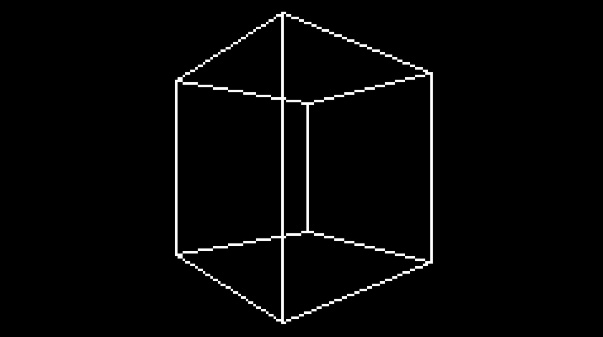

# MiRaster

MiRaster is a **software rasterizer** — a CPU-based 3D renderer, no GPU required.

> **Status: Work In Progress.** This project is in early development. (not like it's ever gonna leave an early stage)

## Features

* It renders... stuff...
* It has shaders... kinda...

## Why?

The main goal of this project is to get falimiar with algorithms and inner workings of rasterizers. This renderer is a sidequest in a journey towards a hardware FPGA rasterizer.

## Important notes to self

* Triangle drawing uses static stuff, so don't expect it to work multithreaded.