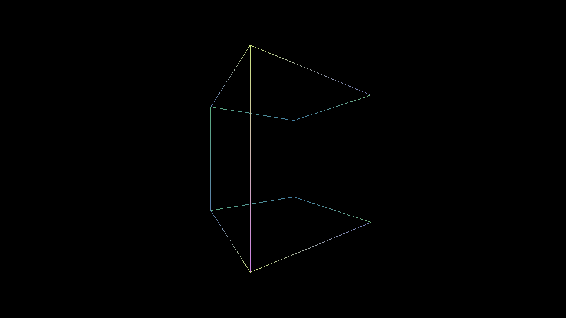
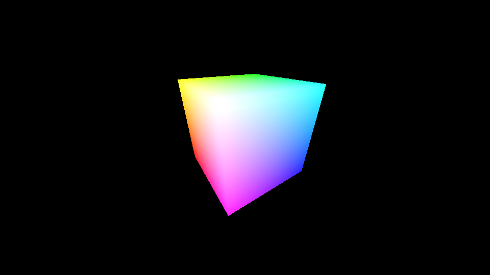
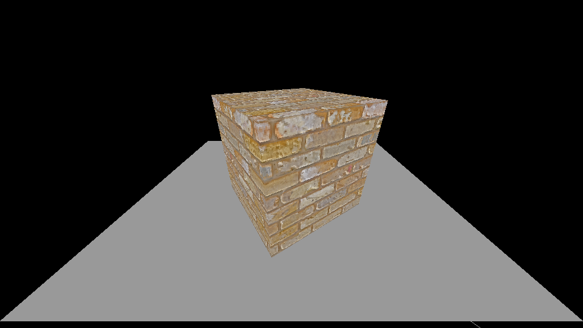

# MiRaster

MiRaster is a **software rasterizer** — a CPU-based 3D renderer, no GPU required.
You feed it triangles, it feeds you pixels.

> **Status: Work In Progress.** This project is in early development.
> (not like it's ever gonna leave an early stage)

## Demo

| Line cube | Triangle cube |
| :---: | :---: |
|  |  |
| Classic wireframe cube, Bresenham-style edge walking with depth testing and a per-edge gradient shader. | Flat-shaded cube. Every face is two triangles with per-vertex colors interpolated across them. |



The textured cube: albedo-mapped with per-face UVs, lit by a simple
`ambient + diffuse` model. Normal mapping is exercised in the shader too
(via `assets/bricks/normal.png` when present).

## Features

* **Triangles** — rasterized with a scanline edge-walking fill, per-pixel depth
  testing (`<=`), and perspective-correct barycentric interpolation helpers.
* **Lines** — Bresenham walk over clamped, depth-tested segments with a
  parametric `factor` exposed to the shader (0 = v0, 1 = v1).
* **A tiny shader system** — a shader is just a function pointer with an opaque
  `data` pointer. The rasterizer does the hot per-pixel plumbing (screen pos,
  depth test, barycentrics...) and the shader decides what color the pixel gets.
* **Scene graph-ish models** — `mr_model` bundles a mesh (indexed, strided
  vertices), a `translation`/`rotation`/`scale` transform, and a shader.
* **Cameras** — perspective projection, `mr_camera_vp_matrix` produces the
  view-projection matrix.
* **Texture sampling** — `stb_image` loading, nearest-neighbor sampling with
  wrap-repeat; textures are assumed tileable.
* **Pluggable `real` type** — vector/matrix math is macro-generated against a
  `real` scalar so it can be retargeted (floating point today, fixed point is
  the plan for the FPGA side).

## Why?

The main goal of this project is to get familiar with the algorithms and inner
workings of rasterizers. This renderer is a sidequest in a journey towards a
hardware FPGA rasterizer — so the code is written
like you'd write it for real silicon: small buffers, explicit passes, nothing
hidden behind driver magic.

## Building

Requires a C compiler (`cc`), [SDL2](https://www.libsdl.org/) (dev package) and
GNU Make.

```sh
make            # debug build (ASan, -O0)
make release    # optimized build (-Ofast -march=native -flto)
make clean
```

This produces:

* `build/<flavor>/libmiraster.so` — the rasterizer core (no SDL2 dependency)
* `build/<flavor>/libmiraster_sdl2.so` — the SDL2 window backend
* `build/<flavor>/demos/<demo>` — one ELF per demo

The framebuffer resolution is selected at compile time through `EXTRA_FLAGS`:

| Flag | Window | Framebuffer | Integer scale |
| :--- | :--- | :--- | :--- |
| (default) / `-DMR_SDL2_MID` | 960×540 | 240×135 | 4× |
| `-DMR_SDL2_LARGE` | 1920×1080 | 240×135 | 8× |
| `-DMR_SDL2_HIRES` | 1920×1080 | 1920×1080 | 1× |
| `-DMR_SDL2_MINI` | 240×135 | 240×135 | 1× |

(e.g. `make release EXTRA_FLAGS=-DMR_SDL2_HIRES`)

## Running the demos

Run them **from the repository root** — the textured demo loads its textures
via relative paths (`./assets/...`):

```sh
./build/release/demos/line_cube
./build/release/demos/triangle_cube
./build/release/demos/textured_cube
```

Each demo spins its subject at a constant rate and prints the render time
every 30 frames. Close the window to exit.

The textured demo expects a PBR brick material in `assets/bricks/`
([source](https://freepbr.com/product/worn-out-old-brick-wall-pbr-material/));
it currently ships with an albedo map only.

## Project layout

```
include/mr/     Public API: fb, model, render, camera, texture, math, types
raster/         Rasterizer core: triangle/line fill, depth, sampling — backend-free
platform/       Windowing backends (SDL2: window, blit, frame pacing)
demos/          One .c per demo, plus demos/common/main.c scaffolding
assets/         Textures
```

The core never touches SDL2 or a window — it renders into a
`struct mr_fb_desc` you own (pixels + depth buffer) and the platform layer
blits it. `demos/common/main.c` is the complete platform contract:
`platform_init / get_fb_format / should_exit / blit_fb / await_vsync`.

## Important notes to self

* Triangle drawing uses static state, so don't expect it to work multithreaded.
* Textures are assumed tileable — repeat is the only wrap mode.
* Shaders deliberately receive the *minimum* per-pixel data; anything they
  don't need is not computed for them.
